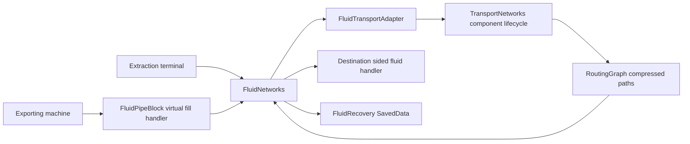

# Fluid pipe networks

Power Advantage fluid pipes are ordinary blocks backed by one server-side network
manager per dimension. They have no block entity, per-pipe ticker or fluid buffer.
The shared transport core discovers loaded components and caches compressed routes;
the fluid layer performs sided capability transfers and owns exceptional remainders.

For a downstream pipe implementation, start with [the Java extension example](#defining-a-pipe-in-a-downstream-mod).
For the resource-independent API used by both fluids and conveyors, see
[the transport core](transport-core.md).



## Implemented behavior

`fluid_pipe` and `fluid_pipe_terminal` are MMDLib standalone blocks. Each has six
connection booleans, and their shapes match the existing eight-pixel-wide pipe
models. The source-facing property is ordinary persisted block state, so neither
block needs a block entity or per-block ticker.

An extraction terminal initially extracts from the block it was placed against.
Right-click a face of the terminal to select that neighboring source; the action
bar reports the selected direction. Attach ordinary pipes to transport the fluid
to neighboring fluid handlers. A machine that already exports fluid, such as the
steam source or drain, can push directly into ordinary pipes without a terminal.
Plain tanks connected to pipes do not become extraction sources automatically.
There are no new crafting recipes in this implementation; both blocks appear in
the Power Advantage creative tab.

Pipes expose a fill-only virtual fluid handler: one empty virtual tank with a
capacity equal to that block's transfer rating, representing transport throughput. They do not contain fluid,
and draining that interface returns empty. This prevents neighboring pullers from
silently draining arbitrary tanks behind a network. To feed a pull-only consumer,
use a terminal at the source; the network inserts into the consumer's fluid handler.
A network with no accepting destination refuses the offered fluid.

`FluidNetworks` delegates discovery and component lifecycle to the shared
`TransportNetworks` manager; `RoutingGraph` compresses physical connections.
`FluidTransportAdapter` supplies fluid-specific topology and endpoint policies.
See [the shared transport API](transport-core.md). Endpoint capability caches include sided access and null
results at occupied boundaries. NeoForge capability invalidation rebuilds affected
components when capabilities appear/disappear or providers are replaced. Contents
and acceptance are simulated live, rather than cached as permanent resource rules.
Current injection sources and every explicitly configured extraction source are
excluded from destination selection. Endpoint positions/faces are treated as
capability identities; multi-block providers must correctly expose their handlers
and invalidate capabilities when changing configuration.

A connected network shares **the minimum transfer rating of all its pipes per server
tick**, regardless of how many pipes or callers it has. Built-in pipes and terminals
default to 1,000 mB/tick. A slow side branch also constrains the entire component;
this is a component-wide budget, not independent per-route or per-edge throughput. Recently active ingress points receive rotating turns;
equal accepting destinations and extraction terminals also receive rotating
service. Demand expires after 40 ticks, so a recently idle input can briefly retain
a turn. This favors fair service over maximum instantaneous utilization. A new
source may wait until the next turn. There is no fluid travel time or pipe volume;
transfers are direct and completed synchronously at their endpoints.

Per-dimension tick budgets are 512 topology/compression steps, 512 shortest-path
steps (up to 32 per network per pass), 256 simulated destination attempts, and 256
executed/source attempts. At most one matching chunk section (4,096 positions) is
scanned per tick, after cheap palette checks. Route caches and outstanding route
jobs each hold at most 32 ingress routes per network. A cold route refuses transfer
until budgeted Dijkstra computation finishes. Straight-chain interior entries now retain exact reachable paths through the
compressed graph, including the correct direction on one-way transport.
Fair destination rotation takes precedence over strict nearest-first delivery.

The work budgets limit world queries and graph work; they are not a measured
millisecond guarantee. Component invalidation, collection bookkeeping, path/list
allocation, endpoint scheduling and capability implementations still have costs
that scale with their data. This has not been benchmarked on a large modpack.

Chunk unloads suspend affected components; no routing operation requests a chunk
load. Topology is derived again from loaded blocks after restart. Chunk event
inspection waits until the exact chunk instance is available from `getChunkNow`,
avoiding access before FULL promotion. Dimension unload releases the manager.

Routine transfers do not use network storage. If a source has actually been
extracted and the receiver unexpectedly refuses execution, `FluidRecovery` keeps
the remainder in dimension SavedData and retries delivery or return to the source.
The record persists even if the pipe/source is removed or unloaded. Reconnecting
that position or restoring a source that accepts its return permits recovery.
This safeguard covers terminal-owned extraction; external exporters remain
responsible for honoring the actual amount returned by `fill`.

## Code walkthrough

The implementation is split by ownership rather than by pipe position:

| Source | Responsibility |
| --- | --- |
| [FluidPipeBlock](../src/main/java/zone/moddev/mc/poweradvantage/blocks/FluidPipeBlock.java) | Connection state/model selection, source-face selection and virtual capability registration |
| [FluidTransportAdapter](../src/main/java/zone/moddev/mc/poweradvantage/network/FluidTransportAdapter.java) | Pipe recognition, bidirectional adjacency, endpoint watches and static source exclusions |
| [TransportNetworks](../src/main/java/zone/moddev/mc/poweradvantage/network/transport/TransportNetworks.java) | Loaded chunk indexes, invalidation, replacement discovery and component publication |
| [RoutingGraph](../src/main/java/zone/moddev/mc/poweradvantage/network/transport/RoutingGraph.java) | Incremental compression, bounded Dijkstra jobs, route caches and physical path reconstruction |
| [FluidNetworks](../src/main/java/zone/moddev/mc/poweradvantage/network/FluidNetworks.java) | Transfer admission, live acceptance, fairness, terminal extraction and retry policy |
| [FluidRecovery](../src/main/java/zone/moddev/mc/poweradvantage/network/FluidRecovery.java) | Durable ownership of exceptional terminal extraction remainders |
| [NetworkEvents](../src/main/java/zone/moddev/mc/poweradvantage/network/NetworkEvents.java) | Server tick, chunk and dimension lifecycle forwarding |

### Placement and discovery

1. Block placement/removal or a meaningful neighbor change reaches `changed`.
   Published affected components become invalid immediately, including their old
   channel IDs, and provisional work is withdrawn.
2. `TransportNetworks.tick` processes unloads before loads, then one section scan.
   Loaded-chunk inspection waits for the same instance to be available through
   `getChunkNow`; `available` guards world access without loading chunks.
3. `rebuildComponents` spends its fixed step budget on seeds, adapter inspection
   and graph compression. Capability watches retain null results at occupied
   boundaries so a provider appearing later can invalidate and rebuild the graph.
4. `publishBuild` installs the complete graph, node set, source list, minimum rating
   and fair quantity allowance before marking the component valid. Partial graphs
   cannot accept a transfer.

For pipe channels, weak and outgoing adjacency are both bidirectional. Compression
retains junctions, endpoint attachments, terminals and an anchor in each otherwise
vertex-free cycle. Physical paths are retained even though routing decisions skip
ordinary degree-two pipe positions.

### Pushed transfers

An exporting machine queries a pipe's sided fluid capability and calls `fill`.
`FluidNetworks.route` resets operation accounting for a new world tick, checks
loaded/valid topology and the reentrancy guard, then requests its ingress turn and
shared quantity allowance. A cold route returns zero until its bounded shortest-path
job finishes; this is backpressure, not a permanent rejection of that fluid.

`transferToDestinations` visits cached candidates in rotating order, skips the
injecting block and explicit extraction sources, and checks the live capability
and its current acceptance. The cached data describes reachability; it does not
assume that a previously full tank is permanently unavailable. Simulation calls
the handlers in simulation mode without consuming fluid quantity or advancing the
accepting-destination cursor. Simulations still consume CPU-operation allowance
and can register ingress demand.

After executed handlers return, `commitDelivery` charges only the accepted amount
and advances the destination cursor past the actual accepting endpoint. The
reentrancy guard is cleared in `finally`, including if a provider throws. External
exporters must honor the actual amount returned by `fill`.

### Terminal extraction and recovery

`extract` checks a loaded source, simulates its offered fluid and simulates the
route's acceptance. `executeExtraction` then extracts only the agreed quantity and
routes the actual returned stack. Any amount unexpectedly refused during execution
is copied into `FluidRecovery`, preserving its original ingress, source and face.

`retryRecovery` first retries network delivery, then tries a budgeted refund into
the original loaded source. It dirties SavedData when quantities change and removes
an entry only after its owned contents are empty. Breaking a pipe does not delete
recovery ownership; restoring a usable ingress or refundable source permits retry.
This is a safeguard for terminal-owned extraction, not a transactional guarantee
for arbitrary external handlers or crash-interrupted inventory operations.

### Unload and restart

A queued chunk unload makes routing fail closed before its next topology pass.
Processing it excludes that chunk and invalidates affected components. Reloads seed
known neighbors and rescan relevant sections. Level unload releases the dimension
facade. Pipe topology and caches are rebuilt from blocks after restart, while
exceptional fluid ownership is restored from dimension SavedData. Do not persist
component generations as network IDs.

## Verification

```sh
python3 scripts/validate_pipe_models.py
./gradlew -PgameTests runGameTestServer build --offline
```

The resource validator checks both sets of 64 variants against rotated geometry,
including every model/texture reference and duplicate JSON keys. GameTests cover
compression, no block entities, all six connections, simulation and shared budgets,
split/merge and stale capabilities, passive tanks, explicit extraction, destination
and competing-source fairness, live acceptance, endpoint replacement, loops,
capability appearance, persisted exceptional remainders, and chunk-boundary
suspension/reconnection, alongside the five original machine tests.

The chunk-boundary test feeds the actual chunk-event queues while keeping the
GameTest arena loaded; it is not a full physical chunk-unload/restart stress test.
Client appearance, manual placement/direction selection and real third-party pipes
still need interactive validation.


## Defining a pipe in a downstream mod

The Java constructor accepts a positive `int` in **millibuckets per server tick**.
The two-argument constructor retains the 1,000 mB/tick default. Ratings are immutable
for a registered block; read a config value during block creation if desired.

```java
public final class LargeFluidPipe extends FluidPipeBlock {
    public LargeFluidPipe(BlockBehaviour.Properties properties) {
        super(properties, false, 2_048_000);
    }
}

// Or instantiate directly; true selects an extraction terminal with the same rating:
var largeTerminal = new FluidPipeBlock(properties, true, 2_048_000);

// In your mod-bus RegisterCapabilitiesEvent listener, after block registration:
FluidPipeBlock.registerCapabilities(event, LARGE_PIPE.get(), LARGE_TERMINAL.get());
```

Imports are `zone.moddev.mc.poweradvantage.blocks.FluidPipeBlock` and
`net.minecraft.world.level.block.state.BlockBehaviour`. Register blocks/items and
supply assets using the consuming mod's normal NeoForge or MMDLib registration.
The network discovers every `FluidPipeBlock` subclass, including ones registered
under another mod namespace. No Power Advantage registry list needs updating.

`getTransferRate()` returns the block's rating. A network made entirely of
2,048,000 mB/tick pipes and terminals can transfer that amount per tick, subject to
source/destination capability limits and scheduling. Connecting a built-in pipe or
terminal reduces the shared component limit to 1,000 mB/tick; replace every
bottleneck, including the terminal, to restore the higher rating. Rates from 1 to
`Integer.MAX_VALUE` are accepted, matching NeoForge's fluid handler amount range.
Zero and negative ratings fail construction. Fluid volume changes do not increase
the number of graph steps or capability attempts allowed per tick.

## Redstone fluid switch

`poweradvantage:fluid_switch` participates as a standard rated pipe while its
`active` state is true. Redstone power makes it inactive, isolating all faces.
It uses ordinary block state rather than a block entity. State transitions suspend
old routes before neighbor notifications and trigger an incremental split or merge.
Closed valves are not destination endpoints; cached ingress handlers cannot route
through them. See [PA2 content restoration](pa2-content-port.md) for recipe and API details.
